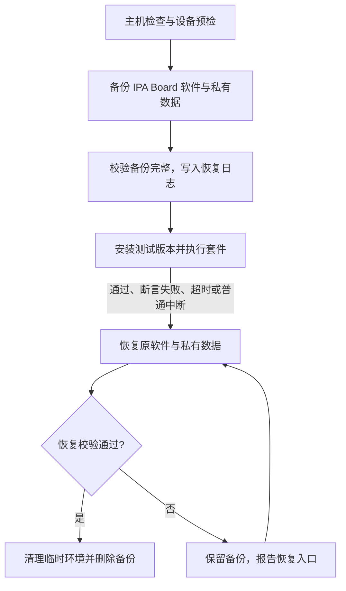

# 测试流程与维护规则

此流程取代 README、引擎文档中的直接设备测试命令。所有贡献者及自动化代理遵守仓库根目录的 [AGENTS.md](../AGENTS.md)。历史测试报告只说明当时的结果，不作为当前版本通过的依据。

## 必须保护测试机

**回归测试开始前需要备份测试机的软件状态与配置；回归测试完成后应该将测试机上的软件状态回滚至回归测试开始前，并删除备份。**

设备测试唯一入口是 `tools/regression.py`。Gradle 的 connected/managed-device 测试任务会拒绝直接执行，设备测试 runner 也拒绝缺少快照标识的调用。标识用于防止误操作，不是对恶意调用的安全认证；不得自行构造标识绕过备份。



用户已明确范围：**仅对 IPA Board 软件和软件产生的用户数据快照，不包含其他应用或系统设置。** 测试包是本工具的附属组件，原有安装也会复原。磁盘快照内容如下：

| 对象 | 备份及验证内容 |
| --- | --- |
| `com.example.ipa_board`、`.test` | 原有安装状态、全部 APK/split APK 及 SHA-256；原来没有安装的包在结束时移除。不会为解决签名不匹配而卸载原有应用。 |
| 应用数据 | CE/DE 私有目录，包括布局、设置、数据库、剪贴板历史、颜文字、已下载 Emoji、引擎部署资源、`no_backup`、缓存；验证路径类型、UID/GID、权限模式、时间戳及文件内容。APK 安装器管理的 `lib` 链接由原 APK 恢复；缓存目录的系统组及 setgid 属性也必须保留。 |

系统输入法配置、系统权限、app-op 及包启停等不写入快照。流程为了停止受测进程、暂时隔离 IPA 输入法而读取的环境状态只在内存中保留，在正常完成、断言失败、超时及普通中断后的清理中复原。突然断电或 SIGKILL 后，这些内存状态无法恢复；手动恢复仅承诺原 APK 与私有数据，不承诺回到原系统配置。

app-op 校验区分模式配置与使用记录：向当前设备上的不存在 UID 只读查询系统默认模式，比较包级和 UID 级的非默认配置。振动、读取剪贴板等操作留下的默认模式使用条目及时间戳不代表配置变化；所有非默认设置仍须恢复并严格匹配。无法识别默认模式输出时停止，不使用硬编码默认值或跳过验证。默认模式和原临时环境都仅保留在内存中。

需要解锁的 owner user 0、可通过 `run-as` 读取的 debuggable 安装，以及支持恢复 stopped 状态的 Android 系统。不支持读取既有 release 私有数据时，改用专用模拟器；禁止卸载或清数据后继续。另一用户/工作资料中有同包安装时也停止。备份存放在主机临时目录的 `ipa-board-regression-<uid>/snapshot-*`，目录为 0700，不进入 Git；恢复日志按阶段原子保存，防止中途退出后丢失恢复入口。

这是上述持久化范围的恢复，不是整个操作系统的快照。既有进程的运行现场、用户原有编辑器文字、系统剪贴板、账户、密钥库、系统任务和其他应用数据不在此范围，自动套件不得修改其他应用的进程或用户文本。受测进程可以停止/重启，测试编辑器只用合成文字；不恢复此前进程的运行现场。需要扩大快照范围时先询问用户。专用只读模拟器还应关闭快照保存，避免退出时持久化测试修改。

## 执行步骤

先在主机完成确定性检查；不必连接设备：

```sh
python3 -m unittest discover -s tools -p 'test_*.py'
python3 tools/regression.py validate
python3 tools/verify_engine_assets.py
./gradlew testDebugUnitTest assembleDebug assembleDebugAndroidTest lintDebug --offline --console=plain
```

使用项目要求的 JDK 和已配置的 Android SDK。依赖未缓存时先解决构建环境，不要将设备数据清理当作构建排错步骤。

`app/lint-baseline.xml` 仅登记维护者接受的既有 136 项 `NewApi` 错误（最低安装声明 26，最低适配 API 仍为 35）。这些匹配项不再阻断 Gradle Lint；其他警告及新增 `NewApi` 继续报告，新增错误仍使检查失败。基线不代表低版本兼容问题已经修复。更新基线必须单独审阅差异，不要将 `updateLintBaseline` 生成的全部警告自动纳入。此机制适用于 Gradle Lint 与 IDE 批量检查；Android Studio 编辑器内的实时检查仍可能标注既有问题，见 [Android 官方说明](https://developer.android.com/studio/write/lint#snapshot)。

当前脚本自动运行 debug 变体。签名 release 的安装/运行验证须先提供符合上述应用快照范围的入口；本流程不会把 debug 结果当作 release 验证，也不允许为检查 release 绕过保护直接安装。

随后指定设备序列号（不要自动选择第一台设备）：

```sh
python3 tools/regression.py pending
python3 tools/regression.py run --suite smoke --serial DEVICE_SERIAL --no-build
python3 tools/regression.py run --suite full --serial DEVICE_SERIAL --no-build
```

排查完整套件时可加 `--keep-going` 收集所有普通 JUnit 断言失败/跳过，而不反复执行前缀。最终结果仍为失败并回滚；进程崩溃、没有完整结果、超时、中断或环境错误立即停止。报告列出实际执行/通过/失败/跳过数量，未执行的类不能算作通过。

维护回归脚本、修改备份逻辑或首次启用新测试机时，增加 `--verify-roundtrip`：在外层原状态备份保护下创建合成 CE/DE 文件、应用配置与缓存，取得内层已安装应用备份，再扰动这些私有数据，验证实际 APK/数据恢复后继续测试。内层失败会保留两层备份；外层恢复入口先处理内层，再恢复测试机原软件状态。此验证不使用用户输入或配置作为测试样例，也不扰动系统设置来验证快照。

`--no-build` 使用上一步构建的 APK，脚本仍核对包名、debuggable 和专用 runner。不提供时先离线构建两个 APK。流程如下：只读预检 → 在内存中保留临时环境并停止受测进程 → 复制/校验原 APK 和私有数据 → 写入已完成备份的日志 → 安装测试版本并隔离测试数据 → 按类执行所选套件 → 停止测试进程 → 恢复原 APK/数据 → 校验 → 清理临时环境 → 删除备份。恢复期间先临时隔离 IPA 输入法，避免它写入正在恢复的数据。

测试断言失败、超时、Ctrl-C、SIGTERM/SIGHUP 都进入恢复。恢复期间普通中断被延后；不要拔线或关闭测试机。SIGKILL、主机断电、设备掉线不能保证当场恢复，日志保留；下一次 run 遇到未完成备份会拒绝继续。

恢复失败时**保留备份**，不能把测试报告标为完成或手动删除唯一备份。重新连接原设备、解锁原用户后，使用脚本打印的路径：

```sh
python3 tools/regression.py pending
python3 tools/regression.py restore /PRIVATE/PATH/snapshot-XXXX --serial DEVICE_SERIAL
```

恢复入口校验原设备/系统构建和备份完整性，不会用不完整或损坏的 tar 覆盖原数据。备份只完成一部分、尚未开始安装/清数据时，不用不完整备份覆盖应用；跨进程恢复不读取不存在的历史系统设置。校验失败继续保留备份并报告原因；需要人工处理时先说明受影响对象和可恢复证据。正常回滚后备份目录删除，测试报告留在 `app/build/reports/regression/<id>/`。这些报告包含测试输出，亦不提交私人设备信息或配置。

## 候选流水线专项计时

针对候选到达时间差的调查，使用独立入口：

```sh
python3 tools/regression.py run --suite candidate-timing --serial DEVICE_SERIAL --no-build
```

先完成上面的主机检查。此入口同样执行完整的软件/私有数据备份、恢复校验和备份删除；不直接使用 instrumentation、logcat 或读取私人输入。测试使用固定合成输入、真实 Rime/Mozc/LatinIME 服务、真实 `CompositionController` 与 `ImeChromeView`，不操作其他应用、系统剪贴板或真实编辑器。ARM64 另测内置 IPA 引擎；其他 ABI 不宣称 IPA 已验证。E5、计算器和短信功能在本套件关闭，E5 的 debounce/推理性能仍由单独的语义测试调查。

套件涵盖首次观察到的查询、`yes` / `shide` / `soudesu` 各五轮热查询、40ms 字符间隔的快速连续输入、零间隔突发查询、空结果、全引擎关闭，以及 ARM64 上的 IPA 查询。首次查询不保证磁盘/系统缓存冷启动，是否真正加载引擎需看 `initialize` 阶段。测试不以固定毫秒阈值判定成功；180 秒仅为故障退出上限。还验证关闭探针时不返回时间戳、开启后候选内容不变、release 服务忽略探针，以及观察器异常不影响调用。

| 阶段 | 计时边界 |
| --- | --- |
| `compose_to_query` | 合成文本写入至调用协调器查询前；不包含真实应用的 InputConnection IPC |
| `dispatch_wait` | 协调器开始查询至发往引擎，包含尚未完成的服务绑定等待 |
| `outbound_ipc` | 发出请求至服务收到请求，含主线程调度与接收处理开销 |
| `worker_queue` | 服务收到请求至串行 worker 开始工作 |
| `initialize` | 本次查询的引擎初始化/资源加载检查，热查询通常很短 |
| `engine_query` | 配置引擎并查询，包括拆分、候选遍历与简繁转换等接入层工作 |
| `serialize` | 将候选装入回复 Bundle |
| `inbound_ipc` | 准备发出回复至协调器收到回复，含主线程排队 |
| `decode` | 校验并重建候选对象 |
| `merge` | 汇集已到达候选并执行混排 |
| `publish_callback` | 同步发布回调，包括接收候选及视图更新；与 `render` 有包含关系 |
| `render` | 生产候选栏视图的更新/按钮重建调用；重复内容可能直接返回 |
| `layout` / `software_draw` | 每个已完成样本另行测量测试视图布局及软件绘制，固定视口宽度 1080px，不处于引擎响应的计时回调内 |
| `reply` | 回复在协调器的处理，另标 `ok` / `empty` / `stale` / `error` / `invalid` |

各进程使用统一的 `elapsedRealtimeNanos` 单调时钟，输出单位为毫秒。阶段存在包含和未覆盖的间隙，**不能直接求和作为端到端耗时**。视图未附着真实 IME 窗口，软件绘制不等于屏幕合成/显示时延；需要录屏或系统帧工具才能验证肉眼观感。

报告位于当前回归目录 `app/build/reports/regression/<id>/`：

- `candidate-timing.jsonl`：逐次事件，含请求/预输入版本号、阶段、起止时间、数量及结果状态；无候选正文、编辑器上下文或私人输入。
- `candidate-timing.csv`：同一明细及 `duration_ms`，便于表格比较。
- `candidate-timing-summary.json`：按场景/引擎/阶段汇总样本量、最小值、中位数、p95（nearest rank）及最大值；逐请求给出首批非空发布耗时、所有预期引擎回复耗时、到达差距、到达顺序与非空发布次数。
- 原始 instrumentation 输出及 `summary.json`：保留断言、环境与恢复结果。终端也输出主要阶段的中位数/p95/最大值。

快速输入时尚未执行的旧任务会被合并，旧查询可以没有完整回复；报告将其标为 `incomplete`，不会填入虚构的完成耗时。已执行旧任务的迟到回复标为 `stale`，按原请求归属记录，不能算作新请求完成。正常空结果算作成功回复，失败不算完成；全引擎关闭不生成虚构的引擎耗时。少量热样本的 p95 仅供诊断，不能当作稳定性能承诺。

时间戳通过显式的 debug 测试请求启用，与应用日志开关独立；普通应用查询不发送计时字段、不创建计时日志。可移除的代码集中在 `ime/CandidateTiming.kt`，接入点以 `TIMING PROBE` 注释标记。JUnit 失败时尽量保留已完成测量；崩溃/超时可能没有尚在设备内存中的明细，仍必须执行外层恢复。报告导出失败也必须恢复，不得因此跳过回滚。

## 套件及选择依据

清单由 [regression-suites.json](../tools/regression-suites.json) 管理。所有包含测试的设备类必须登记；`full` 是各主套件的并集，`smoke` 是其中的快速子集。校验禁止遗漏、重复归属和不存在的类。增加类时同步更新清单，不用手工维护总用例数。

| 层/套件 | 目的 | 触发时机 |
| --- | --- | --- |
| JVM + 工具主机测试 | Unicode/长按编码、候选拆分与排名、输入状态、配置编解码、版本解析；备份日志/校验/异常/中断/恢复失败路径 | 每次代码变更，提交前 |
| `smoke` | 组合输入、布局导入事务、引擎设置、快捷粘贴、主要控件可用性 | 每次影响运行行为的变更后 |
| `platform` | Android 真实文件/Preferences/InputConnection 合同、旧配置、组/页面存储、Emoji 缓存及版本查询生命周期 | 配置、数据、编辑器、异步逻辑变更 |
| `engines` | 实际 Rime/LatinIME/Mozc/注音：转换、简繁、纠错、混输、上下文预测、启停与回退 | 引擎适配、词库、native 依赖或候选逻辑变更 |
| `ui` | 设置/管理页、编辑器、清空撤销、长按滑动、候选尺寸/展开、灰色控件、窗口及页面分组 | 界面/资源/触摸逻辑变更 |
| `e2e` | 系统 IME 窗口中用真实按键输入、选择候选、切页/展开/返回、Emoji 提交 | IME/组合输入/页面导航变更及发布前 |
| `semantic` | 真实 E5 模型加载、光标前后文、失效结果拒绝、实时关闭/降级 | 语义模型、排序、协调器生命周期变更 |
| `full` | 以上所有设备主套件 | 集成前、升级引擎/词库后、发布前 |

IPA 接入增加 `ipa` 套件，覆盖离线下载事务、哈希/路径拒绝、引擎与词典独立切换、失败保留旧资源、真实 DEX/JNI 多语言候选及管理页异步生命周期。三个类分别登记于 platform、engines、ui，并纳入 full；真实引擎用例仅支持当前 ARM64 包，其他 ABI 的跳过必须单独报告。

`dashboard` 套件覆盖 #8 的只读状态订阅、共享后端/关闭项、滚动与主设置入口，以及真实绑定键打开/返回时保留预输入。状态仓库的旧连接、旧实例及乱序拒绝放在 JVM 测试；新增设备类 `EngineDashboardTest` 纳入 ui/full，`EngineDashboardImeTest` 纳入 e2e/full，配置兼容与默认布局无入口纳入 KeyboardConfigurationTest。仪表盘不依赖日志开关，不通过发候选查询来验证运行状态。首次验证结果见 [仪表盘验证记录](engine-dashboard.md#验证记录)，后续完整回归见本页的 2026-10-20 记录。

`remote-keyboard` 专项覆盖 #4 Phase 1：`RemoteKeyboardModeTest` 验证独立 Preferences 的原子快照、精确恢复、原始缺失键、四种状态组合、重复周期、控制器重建、连续写入失败及损坏快照；`RemoteKeyboardEnginePolicyTest` 使用离线 IPC 验证批量配置只应用一次、关闭后解绑与旧回复拒绝、手动重开引擎及原文提交。这两类登记于 platform/full。`RemoteKeyboardModeImeTest` 登记于 e2e/full，使用测试自有编辑器验证绑定键、独立短按/长按、左右滑动、Shift/Ctrl 快捷键、模式指示、重开输入会话及预输入不丢失；复用配置、引擎开关和控制器用例。控制器重建与输入会话重开不等同于实机强制终止验证，第三方远程应用和实际网络连接也不在自动测试范围。

`page-engines` 专项覆盖 #22：JVM 验证页面进入与 Remote 退出触发条件；`PageEngineBindingContractTest` 登记于 platform/full，验证完整开关、未绑定/空选择、手动覆盖、Remote 快照保护、失败回退与布局兼容；`PageEngineBindingUiTest` 登记于 ui/full，验证 Choose Engines 的名称、保存/取消/清除、页面重建及重命名/跨组/导入；`PageEngineBindingImeTest` 登记于 e2e/full，使用自有编辑器验证真实切页、重绘、全关闭字面提交与 Remote 退出的当前页应用。复用 Remote、离线 IPC 和页组测试，旧请求回退不依赖真实引擎或网络。

`popup` 专项覆盖 #20：JVM 保护 even-odd 几何、面积重心/零面积、重叠过滤和共享长按状态；`PopupConfigurationPersistenceTest` 登记于 platform/full，保护旧配置与双模式配置序列化；`PopupActionEditorTest`、`PopupKeySettingsTest`、`PopupGestureEquivalenceTest` 登记于 ui/full，覆盖图形编辑、四种变形、对象选择、图层、缩放、历史与操作 Undo、模式切换后的草稿保留、八种手势等价以及屏幕裁剪。`PopupActionsImeTest` 登记于 e2e/full，以系统注入的原始触摸流跨越真实键盘与浮窗，验证 Unicode/功能输入、编辑器焦点和离窗取消后的回返；复用旧按键编辑、经典预览和配置测试。截图/绘制检查仅针对测试自有视图，不读取其他应用窗口。

`popup-ime` 仅选择 `PopupActionsImeTest`，用于快速定位真实窗口坐标、原始触摸流和 Classic 对照；提交前仍按影响范围运行 `popup` 或 `full`。

`emoji` 专项复用 ui/full 中的 `EmojiFeatureTest` 和 e2e/full 中的 `ImeEndToEndTest`，覆盖常用与官方分类的连续分区、空常用提示、菜单跳转不筛选列表、普通滚动同步 status 和菜单选中项、短尾分类定位及常用区更新后的可视位置保持；同时保留两种键盘宽度下最右列边缘点击、同一区域纵向拖动及取消不插入、滚动后点击当前条目只计数一次，以及真实 IME 中的完整 Unicode 提交、连续输入和返回。触摸通过测试自有 RecyclerView 分发，不直接调用条目回调来代替点击；使用独立使用记录目录，结束后删除。JVM 单独验证连续分区模型的分类顺序、完整 Unicode 保留及空目录合同。

普通回归不访问公网。Engine Management 的最新版本展示由测试 runner 注入固定元数据，异步查询另用注入的 transport、时钟及独立 cache 验证成功缓存、失败重试、关闭页面和并发取消。真实上游服务可达性属于单独的人工检查，失败不能与产品离线可用性混为一谈。

`continuous-cursor` 专项复用 platform/ui/e2e 中已登记的八个类，覆盖 #10：方向键事件和修饰键、配置导入导出及独立短按/长按、编辑器保存重开、持续操作的触发与停止、Classic/Popup 八种等价手势、多功能栏取消/重绑/移除，以及真实 IME 的四方向移动、边界与 Unicode 预输入仅提交一次。JVM 覆盖主功能的长按推导与显式配置优先，不引入默认按键或改变退格。实际结果按后续运行记录解释，注册套件不代表已通过。

`clipboard-management` 专项复用剪贴板启动、快捷粘贴和面板合同，并新增 ui/full 中的 `ClipboardManagementTest`，覆盖卡片编辑/取消/重开、元数据保留、多选与重建、选择项 JSON 完整导出、输出流故障及共用颜文字菜单的返回操作。测试仅使用应用私有合成历史和内存输出流，不写系统剪贴板或打开外部文档选择器。JVM 验证多仓库刷新、编辑冲突/空白/重复拒绝及选择导出；系统文件选择器集成保留人工验证。

`clipboard-startup` 专项覆盖 #15 的启动补读路径：`ClipboardStartupSyncTest` 登记于 ui/full，验证旧配置默认开启、独立于 Quick Paste、保存重开/未保存返回、每次启动入口补读、关闭不读取、重复内容及已删除条目不复活、空值/权限拒绝回退、日志关闭时仍同步、逐次耗时和无文本日志。复用快捷粘贴、面板顺序/撤销及诊断合同。测试通过注入合成 ClipData 调用服务的生产启动同步入口，不读取或修改系统剪贴板，不将其当作 One UI 实机故障已复现或已修复。JVM 用可控时钟验证耗时、关闭、失败控制流和日志 sink 故障。

`classic-queue` 专项复用八个已登记设备类：配置序列化和旧格式兼容、混合功能队列与默认项编辑、内外层保存/取消、模式切换草稿保留、完整队列预览、两端截断/返回边界、仅相对激活触点的 32dp 下滑取消，以及 Classic/Popup 共用持续生命周期、Pointer Location、屏幕裁剪和真实 IME 文本/功能派发。JVM 单独保护生成几何、旧配置默认项、显式空队列与超长标签的显示/绑定分离；替换过时的循环选取断言。`classic-preview` 单独选择按键预览测试类，便于定位横向选择和下滑取消。专项登记不代表已经通过，实际结果见后续验证记录。

`keyboard-configuration` 单独运行 `KeyboardConfigurationTest`，用于配置格式、内置预置和程序回退模板的合同检查。维护者提供的初始化 JSON 可按实际需要绑定功能；测试验证往返保留，不以过时的默认绑定限制覆盖用户的新预置。

`calculator` 专项复用 `CompositionControllerTest`、`ImeChromeTest`，`CalculatorImeTest` 登记于 e2e/full：真实 IME 内验证小数/根式双候选、相同结果保留两项、无数字常数、φ 三候选、括号内虚部与 i 结尾、`^`/`pow()` 幂候选、点击后替换预输入、继续运算及字面提交、关闭计算模式和无效算式回退。控制器另验证清除实部/虚部的计算近似省略号，不修改普通语言候选中的省略号。纯语法、根式化简、分母有理化、嵌套降阶、常数与复数四则、主值开方/幂、割线边界及计算容量限制放在 JVM 层，避免以界面测试重复覆盖所有代数规则。

## 测试清理与覆盖维护

建立现行流程时已删除 `ExampleUnitTest`（2+2）、`ExampleInstrumentedTest`（包名）以及 `ClipboardQuickPasteTest`、`EmojiUpdateTest`。后两者主要比较硬编码常量或测试内复制的实现，不能证明生产快捷粘贴和更新流程正确。对应目的由真实生产入口的用例接替，并持续维护以下合同：

| 合同 | 新增/修订的覆盖 |
| --- | --- |
| 快捷粘贴 | 实际 service 状态、次数用尽、超时及关闭后旧回调不能粘贴/消耗次数，重新开启不能复活旧内容。保留发现缺陷的回归断言。 |
| 布局导入 | 无效/过大/读取中断不得改变文件、选择、页组、外观或 revision；成功导入长按半角逗号与功能映射，旧版本默认行为。 |
| 引擎开关 | 独立持久化、snapshot/Bundle 传递、全部原生功能关闭的行为、未知未来设置不被误删。 |
| Emoji | 实际安装目录的缺失/空/损坏/非法内容回退、有效目录与缓存失效；目录升级不依赖固定版本或总数量。 |
| 版本查询 | 成功缓存 5 分钟、失败缓存 30 秒及边界重试；关闭时不阻塞 UI、不发送旧页面回调、关闭后查询不抛异常。 |
| 错误诊断 | JVM 验证默认静默、即时关闭、嵌套加载阶段、固定词汇脱敏、失败输出隔离、限频及成功恢复。platform 验证独立偏好与进程快照、绑定拒绝/权限异常/失效回退、晚到回调及真实 E5 部署目录障碍；ui 验证调试开关操作和重建持久化。正常无候选、缺少可选目录、禁用引擎和过期结果不当作报错。Emoji 离线安装合同覆盖合法替换、无效文本与发布失败时原数据保留。规则及剔除入口见 [错误诊断说明](diagnostics.md)。 |
| 界面 | 候选最小尺寸随键盘几何变化、颜文字动作按键重复排序/管理切换后保持灰色；页面清空支持撤销。按键编辑器切换类型后仍能保存和取消，编辑区域限制高度并可滚动，避免动作按钮被裁切。剪贴板两列卡片跨行等大、列距缩小，超长预览出现省略号；长文和敏感条目的点击回调及测试编辑器仍收到完整 Unicode 原文。剪贴板倒序入口参照颜文字，验证完整序列翻转、按钮状态、刷新保留方向、正常顺序恢复和存储不变；左滑后排序/刷新不会重现等待撤销的条目，撤销和最终删除符合当前顺序；新增记录达到容量上限时，自动淘汰项不再显示无效撤销入口且不误删其余记录。复用状态栏时快捷粘贴与返回键盘后的原状态控件继续可用。 |
| 手势与快捷键 | 长按时间滑块由真实用户操作保存，重建页面和切换页组后保持全局时长；未配置或无效配置回退系统默认，越界配置限制在支持范围内。长按/滑动 fixture 与实际 IME 一样设置普通点击入口，验证同一按键的下一次触摸读取新时长、触发前仍为短按、松手仅提交长按项、取消后无残留计时任务。按用户确定的合同，Ctrl+Backspace、连续退格和配置绑定仍执行普通 Unicode 退格，消耗 Ctrl 状态，不发送按词删除事件。 |
| 英文上下文 | 不跨越其他文字/标点错误取词、系统 locale 不改变引擎输入、长词边界。 |
| 全半角转换 | JVM 覆盖宽度互换、混合方向、片假名浊音、孤立标记、无对应 Unicode 与键帽 Emoji 保留。Android 验证转换后的 composing 长度变化不污染引擎原编码和光标上下文、切换模式拒绝旧候选、提交失败后从原文重试、长文本及结束 composing 不重复转换；保留 Shift 大写、Ctrl 命令和原文粘贴合同。界面验证入口顺序与状态、短按/长按绑定保存及布局兼容；系统 IME 验证工具栏和绑定入口共用状态、换页仍有效，以及真实混输候选最终输出宽度。 |

保留配置编解码、文件事务、管理界面和实际 IME 分别覆盖同一功能的用例，因为它们验证不同边界。修正 Spinner 的显示名/文件名混淆、默认空格键及滑动映射、Emoji 当前分类/实际目录数量、旧 UI 标签和目标窗口定位。删除全屏截图；设备树定位限于受测包。恢复测试 fixture 时保留原 preference 的“缺失”状态，不把缺失擅自变为默认值。

端到端测试共用 `ImeTestDriver`：输入法切换后仅对测试自有编辑器请求显示，沿用原有总等待上限；候选在屏外时滚动到可见位置，异步重绘使点击返回 false 时重新取节点。点击一旦返回 true 就停止重试，并核对完整提交文本与 composing 已结束，防止重试造成重复提交或仅看到预输入原文便误判成功。E5 实时关闭测试等待各原生引擎重新查询后完整基础顺序恢复，不能把首个局部回复当作最终候选。

管理页用例通过实际 Group Settings / Page Settings 分页访问控件，固定预览区直接点击，不对没有 ScrollView 祖先的控件调用 scrollTo。IME 分类/页组菜单用例验证选择后面板和预输入仍在，返回键优先关闭菜单，再返回键盘。`ImeLifecycleTrace` 仅在测试内开启固定生命周期事件，失败时附上该用例的事件；结束后还原原诊断开关和日志文件，不输出输入文本或完整设备日志。

Shift / Caps Lock 指示由 `KeyboardWindowTest`（ui/full）验证真实控制器三态、标签与加粗、自定义符号色和格线开关、临时状态消耗、连续大写与重置；`ImeEndToEndTest`（e2e/full）验证实际输入法中的开启、锁定、连续输入、原文提交及关闭后的状态和大小写。既有控制器与按键预览用例继续保留。

## 后续变更规则

1. 先写清输入/输出及失败/关闭时行为，再选择最小有效测试层；纯规则放 JVM，Android 存储放 platform，native 行为放 engines，实际窗口放 e2e。不要为每个常量或 getter 加测试。
2. 修复缺陷保留能复现错误的用例；旧测试失败先分类：合同过时、fixture/定位错误、环境不支持、产品缺陷。产品意图不清楚时列出原行为、当前界面/文档及两种选择，询问用户；不能删除测试掩盖问题。
3. 输入相关至少考虑 Unicode 码点、组合/直接输入切换、删除与重输、候选过期、全引擎关闭、跨语言及符号/数字边界。新增引擎验证缺失资源/启动失败时仍可原文提交。
4. 配置变更保留旧版本样例，并验证导入失败无副作用、升级/降级的数据保留和未知字段策略。恢复所依赖的私有数据结构变化要重跑工作流主机故障测试与实际回滚验证。
5. 异步测试用明确 latch/事件和可控时钟，避免 sleep、无限等待或为了通过而增加超时。引擎候选验证明确示例和保留性；不要宣称单例排名等同广泛语言质量。
6. 每个设备 fixture 用测试自有目录/配置，在 finally 中清理；不会替代外部快照。新增外部存储、账户、剪贴板写入、持久系统设置或其他应用交互前，先询问用户是否扩大范围，再增加恢复检查及故障用例，不能擅自把系统设置加入快照。
7. 报告记录源码 revision/工作树状态、构建变体、设备 API/ABI、套件与每类结果、测试失败/环境错误及回滚结果。只有测试通过且状态恢复验证通过才可报完成；零用例、崩溃、超时、跳过不能当作通过。

## 发布与人工验证

完整自动回归之外，发布时使用专用设备/模拟器检查以下边界，记录具体环境与结果：

| 场景 | 关注行为 |
| --- | --- |
| 普通文本、多行、密码、数字及无 composing 的编辑器 | 正确上屏/删除/光标；密码等受限框不读取上下文、不显示旧候选。使用测试编辑器及合成文字。 |
| API 35 与目标 API 36；ARM64 与 x86_64 | 真实引擎/模型加载及窗口行为。未执行的平台单独标为待验。 |
| 16KB 页设备 | native 依赖真实加载验证；资源哈希或 ELF 对齐检查不等于运行通过。现有 Mozc/Extensions 对齐限制见引擎文档。 |
| 更新安装及旧配置 | 新旧 APK 升级、原布局/长按/页组/开关/颜文字及 Emoji 目录保留；回滚后原 APK 与数据恢复。正式签名 release 单独验证，debug 通过不代表 release 通过。 |
| 短信本地检测/Android autofill、系统剪贴板与网络 Emoji 更新 | 合成来源、权限拒绝、误匹配、敏感内容、离线/损坏下载；SMS OTP 引擎与自动复制双开关、本地与 autofill 模式互斥、拒绝权限不重复复制。执行前需确认范围并补对应隔离/恢复能力，不使用真实短信和私人剪贴板。 |

已知未解决边界：OTP 关键词子串可能误匹配，例如 `Your postcode is 1234` 或 `PINK shoes cost 1234`。这属于生产解析问题，不能通过断言错误行为或移除测试解决；保留为后续缺陷，新增反例并修正识别规则后验收。真实短信/系统剪贴板集成及广泛编辑器兼容性仍未标为通过。

## 2026-10-03 验证记录

本次验证针对 `0.0.2-dev` 的开发工作树（基准提交 `64fc0fe`，包含未提交变更），不是已提交或发布版本。完整报告记录 debug APK 的 SHA-256，便于区分后续构建。

- JVM 单元测试 85 项、流程/套件校验主机测试 47 项全部通过；debug 应用和测试 APK 编译通过，lint 0 Error、255 Warning。
- 资源校验通过：87 项引擎文件哈希及 118,346,824 字节的 E5 模型重组校验。ELF 对齐检查不作为 16KB 页设备运行证明。
- 专用只读模拟器，Android 15 / API 35、`arm64-v8a`：`full` 的 28 类共 141 项全部通过，0 失败、0 跳过。报告为 `app/build/reports/regression/a2f31874-d701-4e67-9f89-a00f5433a39b/summary.json`，其中 `success=true`、`restored=true`。修订后的端到端套件也单独通过。
- 流程实际验证过已安装 APK 与合成 CE/DE 配置、文件、`no_backup` 和缓存数据的往返恢复，包括目录 UID/GID、setgid 属性、权限、时间戳及内容校验；恢复失败保留备份的路径也已恢复完成。最终完整回归已恢复原安装状态并删除备份。
- 本次未执行实体测试机、API 36、x86_64、16KB 页设备、签名 release、真实短信/剪贴板和广泛编辑器矩阵；这些仍按上方发布流程单独验收。

## 2026-10-08 错误诊断验证

先将此前功能进度提交为 `6dc3e14`；本次诊断验证针对其上的开发工作树。完整报告记录实际 debug APK 和测试 APK 的 SHA-256。

- JVM 单元测试 105 项、流程工具主机测试 47 项全部通过；debug 应用和测试 APK 编译通过，lint 0 Error、255 Warning，未新增 lint 警告。套件清单校验通过。
- 87 项引擎文件哈希及 118,346,824 字节 E5 模型重组校验通过，仍不作为 16KB 页设备运行证明。
- 专用只读模拟器，Android 15 / API 35、`arm64-v8a`：最终 `full` 的 29 类共 169 项全部通过，0 失败、0 跳过。报告为 `app/build/reports/regression/2d65ac9a-363a-4f32-bff5-c7079a8c70c6/summary.json`，其中 `success=true`、`restored=true`。覆盖实际 Rime/Mozc/LatinIME/E5、诊断故障与通信、开关 UI 及 Emoji 离线发布故障。
- 首轮报告 `app/build/reports/regression/d92a29b7-eb99-435e-aca2-10153c27ef6f/summary.json` 中，新增 UI 用例误将 `performClick()` 返回值当作开关生效条件，已改为验证实际选中状态和保存值；另有既有端到端用例在首次获取 IME 窗口时超时，原因尚未确定，完整重跑未再出现。没有删除用例、扩大等待上限或修改生产逻辑来掩盖失败；保留两轮报告区分首次失败和最终通过。
- 两轮均经保护工具备份、回滚和校验成功后删除备份；最终 `pending` 为空，专用模拟器已关闭。未执行实体机、API 36、x86_64、16KB 页设备、签名 release 或真实短信/剪贴板/公网更新检查。

## 2026-10-08 剪贴板倒序验证

- 新增 5 项设备回归，覆盖完整显示序列倒序及恢复、与颜文字一致的按钮样式、刷新保留方向、Unicode/敏感内容完整粘贴、快捷粘贴状态控件重新挂载、真实左滑撤销与提交删除，以及容量淘汰后无效 Undo 关闭。滑动用例登记在 `ui` 和 `full`，仅使用测试自有数据和视图。
- 最终 debug 应用与测试 APK 编译通过，JVM 单元测试 105 项、流程工具主机测试 47 项全部通过，lint 0 Error、255 Warning，未新增 lint 警告。引擎资源校验及套件清单校验通过。
- Android 15 / API 35、`arm64-v8a` 专用只读模拟器：最终 `full` 的 30 类共 174 项全部通过，0 失败、0 跳过；报告 `app/build/reports/regression/1bcf834e-714f-4de9-a35d-46ef57a2d649/summary.json` 中 `success=true`、`restored=true`。容量边界修复前的首轮 173 项也全部通过，保留报告 `app/build/reports/regression/a459adba-4973-445c-9072-1b8f1c5f9d70/summary.json` 区分构建版本。
- 两轮均已恢复并校验原软件安装状态与私有数据，之后删除备份；最终 `pending` 为空，模拟器已关闭。未执行实体机、其他 API/ABI 或真实系统剪贴板操作。

## 2026-10-08 0.0.2 发布准备验证

- `versionName` 已改为 `0.0.2`，`versionCode` 保持 2；开发分支仍为 `0.0.2-dev`。README、更新日志与开发计划当前状态同步更新。
- 离线 `testDebugUnitTest assembleRelease lintRelease` 通过；单元测试任务复用此前 105 项通过结果，release lint 为 0 Error、253 Warning。未改动输入行为，未重新运行设备回归；前述 174 项设备结果对应版本号调整前的 debug 构建。
- 核对生成 APK 的实际 manifest：包名 `com.example.ipa_board`、版本 `0.0.2`、代码 2、最低 API 35、目标 API 36。产物为 `app/build/outputs/apk/release/app-release-unsigned.apk`，`apksigner verify` 确认缺少签名；这是未签名构建检查，不是正式发布包验收。
- 本次未合并、打标签或发布。正式签名 release 的设备/升级验证仍须符合本页状态保护规则，不得直接安装绕过备份。文档本地链接与 30 类设备套件登记校验通过。

## 2026-10-08 v0.0.2 签名包核对

- 用户已手动构建签名包 `app/build/outputs/apk/release/IPA_Board_v0.0.2.apk`，实际 manifest 的版本名为 `0.0.2`、版本码为 2、最低 API 35、目标 API 36。`apksigner verify` 通过，使用 APK Signature Scheme v2；签名证书与旧 `0.0.1` 包一致。
- APK SHA-256 为 `63b1f783b8b307854a9873f4773d42ac13e477a6b85431c6d74556cf42a2326b`。`app/release/app-release.apk` 是相同新包的副本；旧 `0.0.1` 归档 APK 已按用户要求删除。
- 正式版本文档采用 `v0.0.2` 标签命名，README 移除发布步骤。此次仅核对主机上的包和签名，未安装、运行或进行升级测试；不得将上述签名检查及既有 debug 回归视为签名 release 设备验证通过。

## 2026-10-09 IPA 接入验证

- 开发工作树基于 `bed596b`（0.0.3-dev）；debug 编译、设备测试 APK 编译和 lint 通过，JVM 110 项、流程工具主机测试 47 项通过。lint 为 0 Error、257 Warning；93 项引擎资源哈希与 E5 重组校验通过。
- Android 15 / API 35、ARM64 专用只读模拟器：最终 full 的 33 类、184 项通过，0 失败、0 跳过；报告为 `app/build/reports/regression/7ab052f2-97a0-4f23-bb68-d9d5b257ce4d/summary.json`，success=true、restored=true。验证真实 IPA 中英日候选、Unicode 混输、旧引擎打开新二进制词典、旧 mmap 继续可查询，以及独立资源更新、损坏/不兼容/断网回退和管理页生命周期。
- 首轮 ipa 的 10 项中 6 项通过、4 项失败；事务测试发现 `/data/user/0` 与 `/data/data` 的路径身份差异。统一资源根目录为 canonical path 后完整回归通过，保留首轮报告 `21ce8bbb-6aa3-497e-82d0-5ee9bc201f83`，未删断言或增加等待时间。两轮均经保护工具恢复原 APK 与私有数据，校验后删除备份；pending 为空。
- 未执行实体机、其他 API、x86_64 IPA 包、16KB 页设备或签名 release 运行；常规回归使用注入网络，真实上游更新可达性单独检查。

- 完整回归后，真实联网检查发现公共 GitHub API 限流，版本检查改为直接读取仓库 board-update.json，并按 artifactCommit 固定下载产物；兼容性探测增加实际非空 JNI 查询。重新编译、110 项 JVM 与 lint 通过，最后 ipa 套件 10 项通过、0 失败/跳过，报告 `96f325f6-592f-4c69-8b20-8f56530dfc9c` 的 success/restored 均为 true，备份已删除。前一轮清单调整复测也通过，报告 `77e51354-0cfb-40cc-9e4d-9e25ef8cf523`；184 项完整结果对应这两项最终调整前的构建。
- 上游开发分支已发布产物提交 `af73155` 与清单提交 `b46a1b9`。通过电脑已有代理只读验证真实远程清单及 DEX、JNI、词典的长度和 SHA-256，三者均匹配；这是主机联网验证，不是手机公网更新测试。

## 2026-10-20 回归失败修复

本次针对 `38be5b9` 上的未提交工作树，继续处理 #8 首次验收中暂缓的失败，保留全部旧用例与失败报告。

- 管理界面用例改为实际选择 Group Settings / Page Settings 分页；固定预览区直接点击，弹窗的 Delete 操作用按钮 ID 消除标题歧义。清空/撤销、取消、重建与配置持久化断言继续保留。
- 修复显式生命周期 trace 被自动阶段开关过滤，以及 IME 未初始化本地日志上下文的问题。JVM 验证每个显式事件只输出一次、自动静默阶段不受影响及关闭后立即停止；设备验证确切固定事件序列，日志 fixture 使用独立目录。
- 真实 IME 失败追踪证实：可获取输入焦点的分类/页组 PopupWindow 会结束并重建编辑器输入会话，关闭当前面板。菜单改为保留编辑器焦点，统一跟踪和清理浮窗；返回键先关闭菜单，再返回键盘。回归保留 Emoji 分类切换后的预输入、重复 Emoji 提交、页组切换、空组高度、全半角和真实触摸长按，新增菜单返回断言；等待的是退场动画实际完成，没有扩大旧等待上限。
- 回归工具过去将 Android 新增的默认模式使用记录当作 app-op 配置变化，导致收尾误报。现按本设备只读查询到的默认模式规范化包级/UID 级配置，非默认设置继续严格匹配；无法解析则停止并保留恢复入口，临时状态仍不写入快照。主机覆盖默认使用记录、真实非默认配置、未知输出拒绝和差异报告。
- 主机：debug 应用及测试 APK 编译通过，115 个 JVM 测试、49 个流程工具测试全部通过；lint 0 Error、269 Warning。93 项引擎资源哈希及 118,346,824 字节 E5 重组校验通过。
- 最终专用只读模拟器 Android 15 / API 35、`arm64-v8a`：`full` 的 35 类共 193 项全部通过，0 失败、0 跳过。报告 `app/build/reports/regression/af9d783d-ab24-43eb-a4eb-8f8f475ecd48/summary.json`，`success=true`、`restored=true`、`roundtrip_verified=true`。包含实际 APK 与合成 CE/DE 配置、文件和缓存往返恢复验证。
- 原软件及私有数据自动恢复并校验成功，备份已删除，`pending` 为空，模拟器已关闭。首轮保留的快照也已显式恢复验证并删除。未操作实体手机；未验证其他 API/ABI、16KB 页设备、签名 release 或真实短信/系统剪贴板。

## 2026-10-20 Emoji 最右列触摸修复（#3）

验证基于 `820d01e` 上的 #3 分支工作树，debug。Emoji 页改用与颜文字页一致的 GridView 普通纵向滚动和条目点击，不启用快速滚动的扩展触摸区域，也不让单元格单独消费点击；保留复用、类别、字号与普通滚动指示器。

- 新增触摸回归覆盖 280×168 dp 和 360×280 dp 两种键盘区域：最右列边缘按下不插入、抬起准确回调一次；同一区域纵向拖动不插入且确实移动列表；停止滚动后点击回收单元格对应当前条目；取消触摸不插入，使用记录总次数与回调次数一致。使用测试自有视图和独立使用记录目录。
- 旧实现报告 `app/build/reports/regression/5a4ec9c0-894b-4a09-8b9d-49bed04f61a4/` 在最右列边缘点击断言失败，验证用例能发现 #3，测试后恢复并删除备份。
- 首次修复报告 `app/build/reports/regression/31c171a1-3b6d-47c7-9b24-b007a10e0a4e/` 中初始边缘点击已通过，但新增手势 fixture 使用未来事件时间且未等待滚动停止，滚动后的点击失败；现改为真实时间推进并观察原生空闲状态。该轮既有真实长按用例还在初始 IME 显示前超时，未改动其断言或扩大等待，最终完整回归未复现。保留失败报告；该轮软件也已自动恢复并校验后删除备份。
- 主机编译与 115 个 JVM 测试、49 个流程工具测试通过；lint 0 Error、269 Warning。35 类设备套件登记通过，93 项引擎资源哈希与 E5 重组校验通过。
- 最终 Android 15 / API 35 / `arm64-v8a` 专用只读模拟器：`full` 的 35 类共 **194 项全部通过**，0 失败、0 跳过，包含真实 IME Emoji 类别、连续 Unicode 提交、返回及长按用例。报告 `app/build/reports/regression/b4886599-f20e-4392-8a1b-90f69e25988b/summary.json` 为 `success=true`、`restored=true`。
- 原软件与私有数据已恢复并校验成功，备份已删除，`pending` 为空，模拟器已关闭。未操作实体手机；Issue 中的 Samsung One UI 7.0 设备、其他 API/ABI、签名 release 尚未验证。

## 2026-10-20 Emoji 连续分区与分类导航

验证基于 `194012f` 上的 #3 分支工作树，debug。Emoji 使用连续回收网格，常用区在前，随后按目录原有官方分类排列并显示全宽标题；移除 All，菜单选择改为跳转，列表顶部所在分类同步 status 与菜单选中项。

- 新增 JVM 分区合同覆盖官方分类顺序、全部条目及完整 Unicode 保留、独立常用前缀与空目录。设备验证所有分类跳转不筛选条目、普通滚动触发分类同步、空常用提示、短尾分类顶部定位和点击更新常用后保持位置；保留两种键盘尺寸的最右列点击、拖动、取消及回收后点击合同。
- 真实 IME 验证普通滚动更新 status、打开菜单时选中最新分类、菜单跳转保留预输入、完整 Unicode 连续提交与两级返回。触摸 fixture 使用自有 RecyclerView 和独立使用记录，不读取私人输入或剪贴板。
- 主机 debug 应用及测试 APK 编译、117 项 JVM 测试、49 项流程工具测试通过；lint 0 Error、269 Warning，与修改前数量一致。35 类设备套件登记及 93 项引擎资源哈希、E5 重组校验通过。
- Android 15 / API 35 / `arm64-v8a` 专用只读模拟器：`emoji` 专项 9 项通过，报告 `app/build/reports/regression/e358fd82-3890-4f7e-b3c0-80a796bfcfe9/summary.json`；最终 `full` 的 35 类共 **195 项全部通过**，0 失败、0 跳过，报告 `app/build/reports/regression/1f9ff757-fce5-445d-87d6-4bd7f2a49bb9/summary.json`。两轮均为 `success=true`、`restored=true`。
- 两轮原软件与私有数据均已恢复并校验，备份已删除，`pending` 为空，专用模拟器已关闭。未操作实体手机；其他 API/ABI、Samsung One UI 7.0、签名 release 尚未验证。本轮未重复执行额外合成 CE/DE 往返自检。

## 2026-10-20 Caps Lock 状态指示（#11）

验证基于 `835f1db` 上的 #11 分支工作树，debug。渲染层使用控制器的完整 `ShiftState`：关闭为 `Shift`，临时启用为 `Shift •`，锁定为加粗的 `Caps Lock •`；按键预览和无障碍状态同步，沿用页组颜色。控制器切换、输入与序列化逻辑未改变。

- 新增 renderer 用例驱动真实控制器，覆盖临时 Shift 消耗、锁定连续输入、解锁及重置，并在白色/自定义符号色、有/无格线下核对标签、加粗、预览与状态。新增真实 IME 用例核对完整的临时/锁定/解锁状态与 `AABa` 输出及 composing 状态；原控制器、快捷键和触摸长按回归保留。
- 主机 debug 应用及测试 APK 编译、117 项 JVM 与 49 项流程工具测试通过；lint 0 Error、269 项既有 Warning。35 类套件登记、93 项引擎资源哈希与 E5 模型重组校验通过。
- 现有模拟器占用原 AVD，另建专用临时 AVD，使用相同 Android 15 / API 35 / `arm64-v8a` 系统镜像；未操作既有模拟器或实体手机。首轮启用 `--verify-roundtrip`，合成 APK/CE/DE 私有数据往返恢复通过。
- 首轮报告 `app/build/reports/regression/92725503-6504-4939-99d8-e243931acce0/summary.json` 执行 197 项，195 通过、2 失败：新增字体断言未考虑 Android 默认 Typeface 可为空，已修正为空即非加粗，保留锁定必须加粗的断言；旧 `actualTouchHoldCommitsOnlyOnRelease` 在首次显示 IME 节点时超时，尚未执行触摸。新增 Caps Lock 真实 IME 用例当轮已通过。保留失败报告，不修改旧断言或扩大等待上限；该轮恢复校验与合成往返验证成功，备份已删除。
- 最终完整复测报告 `app/build/reports/regression/cc1e2c72-0706-4ac5-a8d3-011b311ba09e/summary.json`：35 类共 **197 项全部通过**，0 失败、0 跳过，`success=true`、`restored=true`。新指示用例与旧长按用例均通过。
- 两轮原软件及私有数据均已恢复校验并删除备份，`pending` 为空；专用模拟器关闭并清理临时 AVD。未验证其他 API/ABI、实体设备或签名 release。本轮未在 GitHub 创建、审查或合并 PR。

## 2026-10-23 远程键盘模式 Phase 1（#4）

验证基于 `e4e6597` 上的 #4 分支工作树，debug。仅实现可绑定的模式切换和引擎状态管理，不包含内置远程传输、蓝牙或 Wi-Fi 连接。切换不提交或清空预输入，退出恢复原配置而非全部启用；记录和引擎覆盖值使用同一 Preferences 事务同步写入。

- 主机：117 项 JVM 与 49 项流程工具测试通过；debug 应用及测试 APK 编译、38 类套件清单和 93 项资源哈希、E5 模型重组校验通过。lint 0 Error、270 Warning，其中新增一项 `ApplySharedPref` 来自恢复快照刻意使用同步 `commit()`，其余 269 项为既有警告。首轮 lint 在新测试源码的 Kotlin FIR 分析中发生工具异常，完成文件写入后重新编译和 lint 通过，未禁用检查。
- 使用独立临时 Android 15 / API 35 / `arm64-v8a` 模拟器，未操作已连接的实体手机或既有模拟器。`remote-keyboard` 专项 6 类 **50 项全部通过**，报告 `app/build/reports/regression/bf25a3aa-d30a-4bbf-a217-c1dc84e1d1c8/summary.json`，`success=true`、`restored=true`、`roundtrip_verified=true`；额外验证了安装 APK 及合成 CE/DE 私有数据往返恢复。
- 最终 `full` 的 38 类 **216 项全部通过**，0 失败、0 跳过。报告 `app/build/reports/regression/8d86a504-9de8-4ecd-bfb2-66eedadf720e/summary.json`，`success=true`、`restored=true`。覆盖全部引擎开关、故障恢复、异步过期回复、实际键盘入口及既有引擎、界面和语义模型。
- 两轮原软件及私有数据均恢复并校验成功，备份已删除，`pending` 为空；专用模拟器已关闭并清理临时 AVD。未验证实体设备、其他 API/ABI、签名 release、真实强制终止恢复或第三方远程应用兼容性；控制器重建及输入会话重开已覆盖，不能将其等同于实机杀进程测试。

### ⌁ 默认入口调整

- 后续工作树将 Remote Keyboard Mode 的绑定键标志统一为 `⌁`，在多功能栏的 status 与全半角键之间加入默认入口；与绑定键共享持久化状态。入口复用既有工具栏按钮样式，打开面板或显示自定义 status 时切换不关闭面板、不替换 status。
- 更新旧的“工具栏无入口”合同，保留默认键盘布局不自动新增绑定的检查；真实 IME 验证通过工具栏开启、绑定键关闭及状态同步。`remote-keyboard` 专项纳入 `ImeChromeTest`，验证入口顺序、样式及开关状态。
- 本轮 debug 编译、117 项 JVM 测试及 lint 通过（0 Error、270 Warning）。专用 Android 15 / API 35 / ARM64 模拟器专项 **56 项通过**，0 失败、0 跳过，报告 `app/build/reports/regression/8f076812-d5d3-4076-aab0-0c9d1cd55e64/summary.json`，`success=true`、`restored=true`；原软件与私有数据恢复校验通过，备份删除，`pending` 为空。未重复运行完整回归，前述 216 项结果属于入口调整前的版本；其他未测范围不变。

## 2026-10-24 浮窗多功能操作（#20）

开发基于 `a06c10c`；配置与几何基础已提交为 `342a722`，编辑器、运行时及回归针对其上的开发工作树，debug。

- 主机：128 项 JVM、49 项流程工具测试通过；应用及测试 APK 编译、43 类套件登记、93 项资源哈希与 E5 模型重组校验通过。lint 0 Error、276 Warning；保留当前建议级警告，没有禁用 lint。浮窗运行时缓存不可变绘制数据，编辑器复用 Path，避免每次绘制造成不必要分配。
- 使用独立临时 Android 15 / API 35 / `arm64-v8a` 模拟器。首轮 `popup` 报告 `app/build/reports/regression/17e20660-8cd4-4e86-a09f-41baba053802/summary.json`：45 项执行，41 通过、4 失败、0 跳过；合成 APK/CE/DE 私有数据往返恢复通过。修正新增测试的浮点精确相等、提示条动画期间提前点击，以及正常 UP 后再断言孤立 CANCEL 的错误；未删除用例或扩大旧等待上限。
- 第二轮 `popup` 报告 `app/build/reports/regression/c6a79bec-8655-4b0a-9488-18cc2b22ecd1/summary.json`：45 项执行，44 通过、1 失败。实际跨窗口输入发现共用 `CompositionController.backspace()` 按 UTF-16 单元删除，会切断 Emoji 代理对。用户明确暂不修复，#20 只验证与 Classic 行为一致；保留完整 Unicode 输入检查，退格改用真实 Classic 物理按键作为文本及 composing 状态基准，不把缺陷输出写成正确预期。该问题仍见[已知缺陷](popup-multifunctional-actions.md#已知的共用功能缺陷)。
- 上述两轮均恢复并校验原软件与私有数据成功，之后删除备份。未操作实体手机或既有模拟器。
- 首轮 `full` 报告 `app/build/reports/regression/56285c83-ed8d-4af7-9ff0-b0fe928ac392/summary.json`：43 类、240 项执行，238 通过、2 失败、0 跳过。旧 `actualTouchHoldCommitsOnlyOnRelease` 在首次获取 IME 节点前超时，尚未执行触摸，历史有同类记录；新增 Popup 真实输入第一次滑动后为空。新 fixture 随后改为先等待本布局的第 3 个按键，并观察按键位置稳定后才注入，而非使用可能尚在移动的首次坐标；未调整文本断言或扩大等待上限。保留原断言及报告，该轮恢复校验成功并删除备份；这些失败不作为通过结果。
- 新增快速 `popup-ime` 验证后两项真实 IME 用例通过，报告 `app/build/reports/regression/41e91514-5c9c-43a6-97ed-f01d4d15942e/summary.json` 为 `success=true`、`restored=true`，备份已删除。验证完整 Unicode 原文输入、实际 Classic 对照、编辑器焦点、离窗立即取消及回返不触发；该结果不等于已修复共用 Unicode 退格缺陷。
- 最终 `full` 报告 `app/build/reports/regression/31aa174a-5d22-49c5-92cf-5fbec209c6d7/summary.json`：43 类 **240 项全部通过**，0 失败、0 跳过，`success=true`、`restored=true`。包含全部 23 项新增浮窗设备用例和原有引擎、配置、界面、端到端及语义模型回归；此前等待节点超时的旧长按用例本轮通过，未改动其断言或等待上限，偶发原因仍未确认。
- 最终已恢复并校验原软件及私有数据，删除备份，`pending` 为空；独立模拟器已关闭并删除临时 AVD。未验证实体手机、其他 API/ABI、16KB 页设备或签名 release；共用 Unicode 退格缺陷按用户决定保留，不作为 #20 已修复项。

### 浮窗拖移、Pointer Location 与无描边

验证基于 `beabc07` 上的后续工作树。编辑器选中浮窗后可直接平移四顶点，内部项目和基准点不随动；普通预览与 Popup 共用实时 Pointer Location 绘制层，沿用屏幕坐标转换、路径/坐标线/准星颜色和差值混合；两处圆形项目均去掉描边并保留反色反馈。

- 新增 4 项设备用例，复用既有测试类和套件：平移与 Undo/Redo/取消回滚、编辑器无描边与图标反色、真实 Chrome→按键→Popup 接线及坐标/颜色/差值/关闭后刷新、运行时无描边与激活反色。仅绘制测试自有视图，不截取其他应用。
- 主机：128 项 JVM、49 项流程工具测试通过；debug 应用/测试 APK 编译、套件登记和 93 项资源哈希/E5 重组校验通过。lint 0 Error、276 Warning。
- Android 15 / API 35 / ARM64 独立临时模拟器：`popup` 的 8 类 **49 项全部通过**，0 失败、0 跳过。报告 `app/build/reports/regression/8a5e6733-e315-47e3-aaa3-864fae80bf6b/summary.json` 为 `success=true`、`restored=true`、`roundtrip_verified=true`。包含实际 APK 及合成 CE/DE 私有数据往返恢复。
- 原软件及私有数据已回滚校验，备份删除，`pending` 为空；临时模拟器已关闭并清理 AVD，未操作既有模拟器或实体手机。本轮未重复完整回归；此前 240 项完整结果对应 `beabc07` 的实现。其他 API/ABI、签名 release 及实体设备仍未验证，共用 Unicode 退格缺陷保持原状。

## 2026-10-24 多功能栏共享预览与绑定（#9）

基于 `5f5595c` 上的 #9 开发工作树，debug。Shortcut Management 与 IME 共用 `MultifunctionBarView`，六个固定位置可独立绑定全部现有功能或文本；status 和候选栏保持专用。配置采用稳定位置/动作标识，与键盘页 JSON 分离；按位置回退损坏或未知动作，编辑时保留其他位置和未知字段。保存后仅刷新工具栏，执行复用服务的现有按键入口；Continuous Delete 在配置的长按时间后重复，离开、松手、取消、重绑定或卸载视图后停止。

- 主机：128 项 JVM、49 项流程工具测试通过；debug 应用/测试 APK 编译、45 类套件登记、93 项引擎资源哈希与 E5 重组校验通过。lint 为 0 Error、277 Warning；新增的可访问性提示来自平台 Button 普通点击经 `super.onTouchEvent` 分发，触摸及可访问点击均有实际用例，未禁用 lint。
- 新增 7 项设备用例，分别登记到 `ui`、`e2e` 及 `full`；专项 `multifunction-bar` 同时包含原有 Chrome 和输入控制器合同。覆盖配置回退/持久化/未知字段、保存取消与页面重建、共享几何、长标签省略与完整绑定、全动作分发、同一模式在多个入口的状态同步、Shift/Ctrl/Caps Lock、面板/status/候选快照保留，以及全引擎关闭时实际文本输入、模式切换和持续删除。
- 独立临时 Android 15 / API 35 / ARM64 模拟器，未操作已运行的模拟器或实体手机。首轮专项报告 `app/build/reports/regression/b2c5d683-1983-499c-bdcc-93b895cbd236/`：5 项执行，4 通过、1 失败，触摸 fixture 在平台 Button 排队的点击回调前读取计数。增加 UI 队列同步及布局就绪断言，未改变产品逻辑或放宽等待；该轮软件及合成 APK/CE/DE 私有数据往返恢复通过，备份已删除。
- 第二轮报告 `app/build/reports/regression/1b7ec4e4-ffbc-434a-b3a4-3a07272a0d7a/`：32 项执行，31 通过、1 失败，新断言误认为关闭全半角转换后预输入显示保持不变。现按既有 `refreshOutput()` 行为验证从原始编码重绘，同时保留重绑定本身不得改变预输入的断言；未修改全半角实现。修正后的专项报告 `app/build/reports/regression/588ff91c-11fc-4391-bc67-f9a1d36c20ae/` 为 **32 项全部通过**；上述各轮均 `restored=true`，备份删除。
- 首轮完整回归报告 `app/build/reports/regression/b2cb176f-ebd3-4111-9dfe-e6a775e9351d/`：45 类、251 项执行，250 通过、1 失败、0 跳过，新增用例全部通过。旧 `widthSwapPreservesNativePinyinEncodingAndCandidateCommit` 在 `awaitKeyboard` 等待 IME 窗口前置条件时超时，尚未执行输入断言；历史有类似窗口等待现象，原因未确认，不记作通过，也未修改旧测试的断言或等待时间。该轮恢复校验通过，备份已删除。
- 保持功能代码、断言和等待时间不变的第二轮完整报告 `app/build/reports/regression/9590e813-e4f8-4379-a42a-30620713c154/`：同为 45 类、251 项执行，250 通过、1 失败、0 跳过。前轮超时的用例本轮通过；`PopupActionsImeTest.originalPointerSelectsPopupTextAndFunctionWithoutLosingEditorFocus` 本轮在同一 `awaitKeyboard` 前置阶段超时，该用例前轮通过。新增 7 项在两轮均全部通过，但两轮完整结果都为失败，不能合并为一轮完整通过；窗口等待问题仍待调查。
- 两轮完整回归均 `restored=true`，原软件及私有数据校验成功后删除备份，`pending` 为空；临时模拟器已关闭并清理 AVD。窗口等待问题另行调查，本次不修改既有功能键逻辑。未验证实体设备、其他 API/ABI、16KB 页设备或签名 release；共用 Unicode 预输入退格缺陷保持原状。

## 2026-10-24 计算器括号分组（#18）

验证对象为 #18 功能分支的未提交工作树，基准提交 `4dd7cfc`。此次仅修改纯 Kotlin 求值器及文档，沿用词法分析 → 调度场算法 → 逆波兰求值流程；不改候选服务、计算模式开关或键盘布局。

- `CalculatorEvaluatorTest` 共 13 项通过，其中新增 7 项覆盖三种括号、全部内外层样式组合、嵌套优先级、分组前/内负号、原有小数格式与除零、空/错配/未闭合分组、禁止隐式乘法、末尾运算符预览及 2000 层嵌套。`1+2/3` 仍为 `1.6667…`，`(1+2)/3`、`[1+2]/3`、`{1+2}/3` 与 `{[1+2]*3}/9` 均为 `1`。
- 最终工作树离线主机检查：135 项 JVM 测试通过（0 失败、0 跳过）；49 项流程工具测试通过，45 个设备测试类的套件登记校验通过；93 项引擎资源哈希与 E5 重组校验通过。
- debug 应用与 instrumentation APK 编译通过；`lintDebug` 为 0 Error、277 Warning。`git diff --check` 通过。
- 本次按纯计算规则选择 JVM 回归层，未连接或修改测试机，未执行设备回归、实体设备或签名 release 验证。既有设备测试结果不作为此次运行证据。
- 未支持的非括号字符仍沿用旧有跳过行为；本次未修复所有未知语法的识别与回退。未新增科学函数、隐式乘法或括号专用默认按键。

## 2026-10-24 计算器二次根式与双候选

验证对象为 #18 功能分支的未提交工作树，基准提交 `ace1039`。追加用户确认的 `√` 与 `sqrt(...)` 两种语法、嵌套根式、小数在前/精确形式在后且始终保留两项的候选合同。普通无根式表达式沿用原 BigDecimal 求值路径。

- 最终 JVM 回归 146 项通过（0 失败、0 跳过），其中根式新增 11 项用例覆盖整数/分数平方因子、同类合并、乘除与分母有理化、嵌套保留/降阶、81 组不同因式分解顺序、精确结果重新输入、非法/非实数/容量限制及候选覆盖层的启停与旧结果清理。`√8+√2` 返回 `4.2426…` 与 `3√2`，`√4` 返回两项 `2`，`√(3+2√2)` 化为 `1+√2`，`√(2+√2)` 保留嵌套形式。
- 49 项流程工具测试、46 个设备测试类的套件登记、93 项引擎资源哈希与 E5 重组校验通过；debug 应用与 instrumentation APK 编译通过，lint 0 Error、277 Warning。最终结果长度保护及精确正负判断调整后，重新通过上述 JVM、编译、lint 与设备专项。
- Android 15 / API 35 / ARM64 独立临时只读模拟器运行 `calculator` 专项：3 类、21 项全部通过（0 失败、0 跳过），其中新增 `CalculatorImeTest` 3 项。初轮报告：`app/build/reports/regression/9ccf77c0-1d62-4b7f-a1ae-0ab2cf5d9dbf/`；最终构建复验报告：`app/build/reports/regression/32dae78e-9783-4a22-b930-2c97c4555fd5/`，均为 21/21 通过。初轮先验证 APK/CE/DE 合成数据往返恢复；各轮专项完成后恢复原软件与私有数据并校验，删除备份，待恢复列表为空，临时模拟器已关闭并清理。
- 精确计算使用表达式内的有理系数与实二次扩张，不以浮点近似判定代数相等或正负；小数以 192 位有效精度估值后显示最多四位小数。支持常见二项嵌套降阶和已有数域中的平方识别，其余保留嵌套根式；不同等价表达式不保证使用唯一的书写形式。
- 为限制 IME 线程工作量，含根式输入最多 4096 字符、最多 8 个独立二次扩张、256 个基项、50000 次内部工作计数；约分后系数分子/分母最多 512 bit，需分解的根式整数最多 128 bit，精确结果正文最多 1000 字符。超过容量、非实数或无效输入均撤下计算候选，保留字面输入及其他引擎候选，不回退为忽略根号的错误计算。
- 未执行此次完整设备套件、实体设备、其他 API/ABI 或签名 release 验证；未新增默认根号键，未支持幂、复数或三角函数。无根式路径仍跳过未知非括号字符的既有问题未修复。

## 2026-10-24 常数、黄金分割比与复数候选

验证对象为 #18 功能分支的未提交工作树，基准提交 `8913712`。本轮合同覆盖前一轮对非实数直接回退的限制：允许复数运算与主值开方，负数被开方数转换为正根式乘 i。按用户后续更正，所有虚部系数（包括 ±1）都置于括号内、i 放在末尾；近似省略号分别跟在对应系数后，虚部的省略号位于括号内。例如 `√(-2)` 返回 `(1.4142…)i` 与 `(√2)i`，`sqrt(i)` 返回 `0.7071…+(0.7071…)i` 与 `√2/2+(√2/2)i`。

- `e`、`π`、`φ`、`i` 可单独或混合参与四则及开方，不需要输入数字才能显示计算候选。根式/e/π/i 表达式提供“小数、精确符号式”两项；含 φ 时提供“完整小数、展开 φ 后的精确根式、保留 φ 的符号式”三项，相同结果仍保留各项。φ 的小数会完成整个分式的求值，精确项保留 `(1+√5)/2` 的根式语义；e、π 在精确式中保持符号。
- 最终 JVM 155 项通过（0 失败、0 跳过），新增 `ConstantComplexCalculatorTest` 9 项，覆盖常数合并/抵消、φ 展开及关系 φ²=φ+1、符号根式、复数四则与主值开方、负分母的正根号、精确结果重新求值、候选数与容量回退。上一版负数根号的错误断言改为本轮复数合同，保留原无效/未闭合语法回归，并为两种负嵌套被开方数补充新结果验证。
- 49 项流程工具测试、46 个设备测试类的套件校验、93 项资源哈希及 E5 重组校验通过。debug 应用与 instrumentation APK 编译通过；lint 0 Error、277 Warning。最后仅补充 JVM 负嵌套样例并重新通过 JVM，生产代码及设备 APK 未变。
- Android 15 / API 35 / ARM64 独立临时只读模拟器：`calculator` 专项 3 类、25 项全部通过（0 失败、0 跳过），包括 `CalculatorImeTest` 6 项、`CompositionControllerTest` 13 项、`ImeChromeTest` 6 项。报告：`app/build/reports/regression/9364d8d0-561c-4160-be65-8c607f1ee27d/`。通过 APK/CE/DE 合成数据往返恢复校验；结束后原软件与私有数据恢复并校验，删除备份，待恢复列表为空，临时模拟器关闭并删除。
- 精确实根式继续使用二次扩张与有理系数；复数按实部/虚部分离计算，符号表达式保留 e、π、φ，允许同类合并、因子抵消和平方根因子消去。e、π 离线计算并缓存约 204 位有效数字，求值采用 192 位有效数字后显示最多四位小数；含符号常数的大小比较使用高精度估值，未将其描述为任意精度的符号判号或完整计算机代数系统。
- 沿用有界容量与原文字面回退；符号层另限制 20000 次内部工作计数、128 个和式项、32 个乘法因子和 8 层符号根号。除已有 `sqrt(...)` 语法与四个常数外，其他字母按用户要求继续跳过，包括根式表达式；原先根式路径的严格未知字符拒绝不再作为当前合同。未新增幂、三角函数、常数专用默认键，也未执行完整设备套件、实体设备、其他 API/ABI 或签名 release 验证。

## 2026-10-24 次幂与 pow 函数

验证对象为 #18 功能分支的未提交工作树，基准提交 `63ddb3a`。按用户确认支持 `^` 与 `pow(底数,指数)`，不增加 `**` 别名。连续幂右结合，优先级高于负号、低于显式根号函数；例如 `2^3^2=512`、`-2^2=-4`、`(-2)^2=4`、`sqrt(-1)^2=-1`。pow 的逗号必须属于对应函数的两参数列表，嵌套函数、负指数与三种分组均纳入回归。

- 整数（含零/负整数）幂精确计算；可构造的分数幂优先使用已有根式、完美有理数根和可构造单位圆相位。一般无理数或复数指数采用 `z^w=exp(w Log(z))`，负实轴取上侧主值，幅角范围为 `(-π,π]`；参考 [NIST DLMF §4.2](https://dlmf.nist.gov/4.2)。不能化简的精确项保持可重新输入的幂式，不将高精度近似系数伪装为精确根式，也不对非整数外层幂作不安全的幂合并。
- 普通纯数字整数幂沿用单结果；非整数幂保留小数与精确式两项；输入含 φ 仍保留完整小数、展开 φ 后的精确式、保留 φ 的符号式三项。虚部继续使用 `(系数)i`，省略号位于系数内。`2^(1/2)` 化为 `√2`，`(-8)^(1/3)` 取主值 `1+(√3)i`，`e^(iπ)` 精确化为 `-1`，`i^i` 提供 `0.2079…` 与精确幂式。
- 最终 JVM 168 项通过（0 失败、0 跳过）：新增 `PowerCalculatorTest` 10 项，覆盖语法/优先级、函数参数、整数与分数幂、主值分支、φ 候选、幂式经过四则/开方后重新输入、未定义/超限回退；新增 `DecimalPowersTest` 3 项，用独立平台数学、固定 Python cmath 参考值与负实轴两侧输入检查高精度数值求值。首次专项发现 pow 逗号后的负号被误判为减号，已修复并保留用例。
- 49 项流程工具测试、46 个设备类的套件登记、93 项资源哈希及 E5 重组校验通过；debug 应用与 instrumentation APK 编译通过；lint 0 Error、277 Warning，`git diff --check` 通过。
- Android 15 / API 35 / ARM64 独立临时只读模拟器运行 `calculator` 专项：3 类、27 项全部通过（0 失败、0 跳过），含 `CalculatorImeTest` 8 项、`CompositionControllerTest` 13 项、`ImeChromeTest` 6 项。报告：`app/build/reports/regression/652b69d5-2475-4cf1-94ba-9dd3cb8770f0/`。先通过 APK/CE/DE 合成数据往返恢复；结束后原软件与私有数据恢复并校验，删除备份，待恢复列表为空，临时模拟器已关闭并清理。
- 数值辅助使用带保护位的 BigDecimal 对数、指数、幅角和三角级数，不引入 Double 求值或外部依赖；仅用于幂的内部计算，不开放 ln/sin/cos 等输入函数。沿用精确系数/根式/输入/输出容量限制，整数指数绝对值最多 10000（中间结果仍受系数容量约束）、保留幂式的运算树深度最多 16；数值部分限制结果量级、角度归约范围及级数迭代，超限保留原文与其他引擎候选。
- `0^0`、零底数非实指数视为未定义；零的正实数幂为零，负实数幂按除零回退。缺失指数不静默忽略幂符号，完整幂式末尾的普通运算符仍支持旧预览合同。未新增默认幂键，未运行完整设备套件、实体设备、其他 API/ABI 或签名 release 验证。

## 2026-10-24 百分号后缀运算

基准提交 `3c0794d`。`%` 将紧邻的数或已完成的括号表达式除以 100，不采用依赖左侧加减数的相对百分比规则。后缀优先于幂及未分组的前缀根号；分组根式或 pow 函数先完成调用，再应用百分号。

- JVM 共 172 项通过，0 失败、0 跳过；新增 `PercentCalculatorTest` 4 项，覆盖连续百分号、负数、四则与隐式乘法、幂/根式优先级、常数/复数及 φ 候选数量、无效输入与候选清理、计算模式关闭和除零回退。
- 首次测试发现 `sqrt(4)%` 错误地将百分号应用于被开方数；已修复，并保留该回归断言。
- `testDebugUnitTest assembleDebug lintDebug --offline` 全部通过；lint 0 错误、277 条既有警告。
- 本次变更集中在解析、求值与候选生成，未运行设备回归，未连接或修改测试机。

## 2026-10-24 排列、组合与阶乘

基准提交 `f8f3de8`。新增 `perm(n,r)`、`comb(n,r)` 与后缀阶乘 `!`，仅接受非负整数，排列/组合要求 `r≤n`；不将非整数近似值舍入为整数。二参数函数共用参数解析，保持 pow 的嵌套、逗号归属与负参数校验。阶乘和百分号采用后缀优先级，可与分组、幂、根式及常数组合。

- JVM 177 项通过，0 失败、0 跳过。新增 `CombinatoricsCalculatorTest` 5 项，覆盖零值/边界、嵌套函数、阶乘优先级及隐式乘法、精确大整数、符号参数与候选数量、非法输入与容量回退；用 0..12 的独立阶乘恒等式逐项核对排列和组合结果。
- `testDebugUnitTest assembleDebug lintDebug --offline` 通过；lint 0 错误、277 条既有警告。最终另调整错误提示及注释措辞，不改变行为。
- 本次仅修改主机可验证的计算逻辑与候选入口，未运行设备回归，未连接或修改测试机。

## 2026-10-24 双参数对数

基准提交 `9a3029e`。按用户确认仅提供 `log(x,b)`，不添加 ln 或单参数 log 对数语法。复数计算采用 `Log(x)/Log(b)`，与幂共用负实轴上侧主值约定，辐角范围 `(-π,π]`；定义参考 [NIST DLMF 4.2](https://dlmf.nist.gov/4.2)。真数为零、底数为零或一时回退为空候选。

- JVM 183 项通过，0 失败、0 跳过；新增 `LogarithmCalculatorTest` 6 项，覆盖必填底数、可证明的有理数化简、嵌套/混合运算、φ 三候选、虚部格式、精确候选重新输入、无效参数及旧候选清理。
- 数值层以平台 Math.log 比值检查 15 组正实数参数，以 Python cmath 固定参考值检查两个复数象限组合，并验证负实轴两侧的主值不连续；不根据近似相等来认定精确化简。
- 首轮新增用例中 `2*log(-1,e)` 的预期文本多写了乘号；实际结果遵循既有 `2π` 输出格式，已修正测试断言，未改变该格式。
- `testDebugUnitTest assembleDebug lintDebug --offline` 通过，lint 0 错误、277 条既有警告。`git diff --check` 通过。
- 本次修改解析/求值及候选生成，未运行设备回归，未连接或修改测试机。

## 2026-10-24 三角、反三角与角度候选

基准提交 `57cc9ea`。提供 `sin/cos/tan/asin/acos/atan`，普通三角参数默认弧度，`°` 后缀显式按角度解释数值。反三角结果携带角度单位；最终为一次角度时，依次显示角度、弧度、斜率各自的小数和精确式，共六项，相同文本保留，含 φ 也不再追加第七项。角度在 sin/cos 内或角度相除后消去，恢复普通数值候选；tan 产生斜率，仍须六项换算。单位不匹配的加减不计算。斜率为正切，正切极点显示两个不可替换预输入的 `Undefined` 占位项。

- 高精度三角计算复用已有正弦/余弦、反正切、指数及对数实现；复数反三角公式参考 [NIST DLMF 4.23](https://dlmf.nist.gov/4.23)，割线上采用实轴上侧/虚轴右侧连续极限。常见角度按代数相等化简，不以小数接近代替精确证明，不应用 `atan(tan(z))=z` 等越过主值范围的恒等式。
- JVM 194 项通过，0 失败、0 跳过；新增 `TrigonometryCalculatorTest` 6 项及 `AngleCalculatorTest` 5 项，覆盖精确角度、弧度默认值、角度消除/保留、函数参数数量、复数、极点、候选重复、φ、选中精确角度后继续运算、非法单位和容量回退。数值层与独立平台数学及 Python cmath 固定参考值比较，并检查反三角割线两侧。
- 补充回归时按最终六项合同更新早期双候选预期；`sqrt((30°)^2)` 沿用已有符号 π 幂的未化简根式，测试验证单位及数值，不承诺新增根式化简能力。
- 49 项 Python 工作流测试、46 个 instrumentation 类登记、93 项引擎资源哈希及 E5 重组校验通过。`testDebugUnitTest assembleDebug assembleDebugAndroidTest lintDebug --offline` 通过；lint 0 错误、277 条既有警告。`git diff --check` 通过。
- 独立临时 Android 15/API 35/arm64-v8a 模拟器通过保护工具执行 `calculator` 专项。首轮 `5d4e959a-f4e2-48f9-a7ff-5f5b3c752170`：IME 10 项中 9 项通过，Undefined 用例在 `awaitKeyboard` 等待窗口出现时超时，尚未执行功能断言；与既有等待问题症状相同，原因未确认，记录保留，未扩大等待时间。
- 最终报告 `605dd324-8c10-41c8-9a5f-5d7231065580`：三个类共 30 项通过，0 失败、0 跳过（`CalculatorImeTest` 10、`CompositionControllerTest` 14、`ImeChromeTest` 6）。新增真实 IME 用例覆盖六项显示、选中角度后继续运算、角度消去后的数值候选和 Undefined 保护；控制器新增占位点击保持原文/修订号不变的检查。
- 两轮原 APK、私有 CE/DE 数据均恢复并校验成功，备份已删除，`pending` 为空。首轮额外合成软件/私有数据往返校验通过；临时模拟器已关闭、AVD 已删除，未操作既有模拟器或实体手机。未运行完整设备套件，其他 API/ABI、签名 release 与实体设备未验证。

### tan 斜率结果换算修正

首版误将 tan 的输出当作普通标量，测试也错误地接受了两个数值候选；前述 194 项及设备通过记录不代表已覆盖此合同。按用户纠正，tan 的结果标记为斜率，最终输出同样为角度/弧度/斜率各两项。角度由主值 atan 换算，原始斜率的小数及精确式保留，例如 `tan(45°)` 与 `tan(225°)` 均输出 `45°、45°、0.7854…、π/4、1、1`。sin/cos 仍产生普通数值；斜率参与普通算术时保留其语义，由其他函数消费时按该函数的结果类型处理。若复数斜率为 ±i，反正切不存在有限值，角度/弧度四项显示 Undefined，保留原斜率两项。

- 最终 JVM 195 项通过，0 失败、0 跳过；新增专项覆盖 tan 六项顺序、主值周期、零/负斜率、算术传播、其他函数消费与复数未定义角度。编译、AndroidTest APK 与 lint 通过，lint 0 错误、277 条既有警告。
- 真实 IME 新增 `tangentSlopeRendersSixConvertedCandidatesAndSelectedDegreeRemainsEditable`，逐项检查六个候选卡片（含重复文本），选择换算后的角度继续计算；不再仅断言斜率数值。
- 独立 API 35/arm64-v8a 模拟器首轮报告 `26c21d2c-4c3c-48f8-9ddc-83e758a379a6`：31 项中 22 通过、9 项 IME 用例在 awaitKeyboard 阶段超时，均未执行功能断言。报告保留，未更改等待预算或测试断言。
- 复查报告 `ab59f444-3dd6-423f-8bb2-5603ddd2c9a3`：31 项中 30 通过、1 失败、0 跳过；新增 tan UI 用例通过，失败的既有 `nestedAndExactCandidatesRemainReusableAndInvalidInputKeepsLiteralText` 仍在 awaitKeyboard 阶段超时，原因未确认。不能将本次设备专项标为全通过；未继续重复整套测试。
- 两轮均已恢复并校验原 APK 和私有数据，备份删除，pending 为空；临时模拟器及 AVD 已清理，未操作既有模拟器或实体手机。其他 API/ABI、完整设备套件与签名 release 未验证。

## 2026-10-24 实数 rand 与稳定随机候选

基准提交 `ec20141`。`rand(a,b)` 接受顺序可变的两个可空实数参数：无参数或两项均空默认 `[0,1)`，只有一个非空参数时与零组成半开区间，相同端点直接返回该值。参数按无单位实数求值；复数参数或最终复数结果不显示计算候选。含 rand 的整个算式仅提供一个实数小数结果，不进行多形式候选的第二次求值或追加精确式。

- `CalculatorSession` 仅存当前预输入的随机样本，按调用位置独立缓存；编辑算式、关闭计算或结束输入会话时清空。不同编辑会话独立，无全局用户缓存、持久化或输入日志。默认按四位小数网格等概率采样，窄区间自动增加精度至多 128 位，避免显示舍入至区间外；抽样/拒绝循环与结果长度均有限制。
- JVM 201 项通过，0 失败、0 跳过。新增 `RandomCalculatorTest` 6 项，使用固定种子及可计数/固定随机源验证空参数、倒序/负数/相同端点、嵌套函数与逗号归属、窄区间、常数、实数限制、调用独立性、刷新不重抽、编辑/禁用/重置重抽、会话隔离、错误输入和旧候选清理；不依赖概率碰巧产生不同文本来判断重新抽取。
- `testDebugUnitTest assembleDebug assembleDebugAndroidTest lintDebug --offline` 通过；lint 0 错误、277 条既有警告。`git diff --check` 通过。
- 通过保护工具在独立临时 Android 15/API 35/arm64-v8a 模拟器执行 calculator 专项，报告 `5ab8456b-c4ab-4b3b-b345-939c6c46c5a4`：三个类共 32 项通过，0 失败、0 跳过（IME 12、控制器 14、界面组件 6）。新增真实 IME 用例通过全半角重绘触发同一原始预输入的再次查询，检查随机候选保持不变、选中后继续实数运算及复数参数按字面回退。
- 原 APK 与私有数据均已恢复并校验，备份删除，pending 为空；临时模拟器已关闭、AVD 已清理。未操作既有模拟器或实体手机，未执行完整设备套件、其他 API/ABI 或签名 release 验证。本轮未重复合成 CE/DE 往返自检。

## 2026-10-24 按页完整引擎状态绑定（#22）

验证对象为 #22 分支的未提交工作树，基准提交 `078d94f`。Page Settings 新增 Choose Engines，复用 Engine Management 的功能名称与独立开关粒度，Save 保存完整配置，Cancel 不保存；Clear Binding 返回未绑定状态，不更改当前引擎开关。可选绑定存于页面 JSON，旧页保持未绑定，显式空选择全部关闭；未知标识保留而不写入偏好，损坏的可选绑定不影响布局本身。

运行时在首次进入页面、页面切换或 Remote Keyboard 退出时应用；同页重绘和绑定编辑不反复执行，未绑定目标页不覆盖当前状态。Remote 期间暂停，不覆盖其恢复记录；退出先恢复原状态，再应用当前页绑定。完整开关通过一次 Preferences 提交传递给既有协调器，存储失败提示并尽力恢复之前的配置；同步 commit 的 lint 豁免仅限需要检查返回值的事务方法。

- JVM 204 项通过，0 失败、0 跳过：新增 `PageEngineEntryPolicyTest` 3 项覆盖进入/重绘、空组与 Remote 初始/退出状态。
- 49 项 Python 工作流测试通过；49 个 instrumentation 类登记校验、93 项引擎资源哈希及 E5 重组校验通过。`testDebugUnitTest assembleDebug assembleDebugAndroidTest lintDebug --offline` 通过；lint 0 错误、277 条既有警告。`git diff --check` 通过。
- 新设备合同用例 8 项验证完整配置可开启既有全局关闭项、未绑定和全关闭、同页手动状态、Remote 快照与未绑定退出、写入失败回滚、无效恢复记录、布局 JSON 与未知功能；界面 3 项验证名称/持久化/取消、空选择与清除、重命名/跨组/导入后独立编辑。
- 新真实 IME 用例 2 项验证实际绑定页/未绑定页/全关闭页转换、Shift/布局重绘保留手动引擎开关、Remote 中切页及当前绑定/未绑定页退出，并保持 Unicode 预输入与字面提交。既有 `RemoteKeyboardEnginePolicyTest` 增加 1 项离线 IPC 用例，证明页绑定关闭引擎后丢弃旧回复且保留原文。
- 独立临时 Android 15/API 35/arm64-v8a 模拟器首轮报告 `f800d801-17fa-487e-b966-8e256399af0a`：36 项中 35 通过、1 失败、0 跳过。界面用例在切换 Page Settings 后尝试滚动时目标尚不可见；测试改为无动画设置 ViewPager 目标页并等待主线程空闲，再执行原滚动/断言，未改产品行为或放宽等待时限。该失败记录保留。
- 最终报告 `482695cf-b763-4401-94a3-4b7592cc10fb`：七个类共 36/36 通过，0 失败、0 跳过，`success=true`、`restored=true`。包括绑定合同 8、管理界面 3、Remote 模式 12、IPC 策略 3、页组合同 7、页组界面 1、真实 IME 2。
- 两轮均恢复并校验原 APK 与私有 CE/DE 数据，备份删除，pending 为空；首轮额外的合成软件/私有数据往返校验通过。临时模拟器已关闭、AVD 已清理，未操作既有模拟器或实体手机。未执行本次 full 套件、其他 API/ABI、签名 release 或实体设备验证。

## 2026-10-25 0.0.3 发布准备

验证对象为基于 `15fdea7` 的发布准备工作树：`versionName` 从 `0.0.3-dev` 改为 `0.0.3`，`versionCode` 保持 3；安装声明为 `minSdk=26`、`targetSdk=36`，最低适配 API 仍为 35。文档更新不表示已发布或创建标签。

- `testDebugUnitTest assembleDebug assembleRelease --offline` 成功，包含 release 的 `lintVitalRelease`。JVM XML 记录 204 项、0 失败、0 跳过；本轮 Gradle 判定 JVM 测试任务为 `UP-TO-DATE`，复用了有效结果，未重新执行全部 204 项。
- 实际核对 debug 与 `app-release-unsigned.apk` 的 manifest：版本名均为 `0.0.3`、版本码 3、最低 API 26、目标 API 36。release 产物未签名，编译成功不代表签名安装包验收。
- 49 项 Python 工作流工具测试通过，49 个 instrumentation 类登记与初始化 JSON 解析通过；93 项引擎资源哈希及 E5 重组校验通过。文档相对链接与 `git diff --check` 通过。
- 完整 `lintRelease --offline` **未通过**：137 项错误均为 `NewApi`，另有 277 条警告。降低安装声明后，现有 API 27–33 的主题、窗口 Insets、无障碍、混合绘制、返回回调与 Java 数学接口被识别为低版本不兼容；未添加抑制或修改运行逻辑。原始报告位于 `app/build/reports/lint-results-release.xml` 与同目录 HTML；`lintVitalRelease` 成功不代表完整 lint 通过。
- 本轮仅执行主机检查，未连接或修改设备，未执行完整设备回归、API 26/鸿蒙实机测试或最终签名 release 的安装、运行和升级验证。开发期间的设备结果仍按各自源码、API/ABI 与失败记录解释。

### 签名候选包最终确认

2026-10-25，维护者确认其手动构建的签名候选发布包已验证通过。本条记录维护者的验收确认，不将其改写为自动化设备套件结果。

- 最终只读核对 `app/release/IPA_Board_v0.0.3.apk` 与 `app/build/outputs/apk/release/app-release.apk`：包名均为 `com.example.ipa_board`、版本名 `0.0.3`、版本码 3、最低 API 26、目标 API 36，签名校验通过。
- 两份 APK 的 SHA-256 均为 `ba5e57fae3488a205bc8407b734ce9683681dcbd68adbce44e0e6cf23093a2d6`。此前未签名的 release APK 已不存在。
- 本次最终确认未重新构建 APK、连接设备或执行安装、instrumentation；API 26 与鸿蒙兼容限制保持前述范围。

## 2026-10-25 连续光标控制（#10）

验证对象为基于 `44ec245` 的未提交工作树，`0.0.4-dev`。四方向持续操作将每次调用交给已有方向键逻辑，Classic/Popup 与多功能栏使用各自现有 Continuous Delete 计时及取消机制；未修改默认布局或预输入退格实现。

- JVM 共 206 项通过，0 失败、0 跳过；新增主功能长按推导、显式长按优先及编辑后短按/滑动保留合同。49 项工作流工具测试、49 个设备类登记、93 项引擎资源哈希与 E5 重组校验通过。
- debug 与 AndroidTest APK 编译通过。`lintDebug` 因最低安装声明 26 下的 137 项既有 `NewApi` 错误失败，另有 279 条警告；未屏蔽或扩大低版本适配承诺。本轮没有构建 release。
- 独立 Android 15/API 35/ARM64 临时模拟器，经保护入口运行 `continuous-cursor`。首轮报告 `65572060-d503-4a02-b189-d266c0f2b1a6`：8 类共 67 项，66 通过、1 失败、0 跳过；首次安装 APK/CE/DE 合成数据恢复往返通过，结束时 `restored=true`、备份删除。
- 新增真实 IME 验证在 Classic、Popup 与多功能栏重复移动四方向、松手停止、文本边界、单步与长按分别生效、完整 Unicode 预输入仅提交一次。补充事件层修饰键与失败返回，配置保存重开、全部五种持续功能的 Popup/Classic 等价，以及多功能栏松手/取消/移出/重绑/移除停止；相关测试均通过。
- 首轮唯一失败为 `KeyboardConfigurationTest` 中禁止所有预置包含 Dashboard 的旧断言；维护者在 0.0.3 更新的 QWERTY JSON 已包含该长按绑定。按维护者确认，改为验证所有预置往返保留，继续保护程序回退模板的默认范围，并同步当前功能说明；未改动初始化资源或删除配置测试。
- 更新测试后仅重编译测试 APK，并通过保护入口补跑 `keyboard-configuration`：报告 `ae65b86d-3e65-45ad-8cee-cf210d660654`，11/11 通过，0 失败、0 跳过，`success=true`、`restored=true`；未重复已通过的其他七类，不将首轮失败报告改写为通过。
- 两轮均恢复并校验原软件与私有数据，删除备份，最终待恢复列表为空；临时模拟器关闭并清理，未操作既有设备。未执行完整设备套件、其他 API/ABI、实体编辑器兼容或签名 release 验证。


## 2026-10-27 Classic 长按混合队列与共享预览

验证对象为基于 `83f4b8f` 的未提交工作树，版本 `0.0.4-dev`。新增混合队列、默认项和显式空队列配置；普通预览及 Classic 长按均由 Popup 几何/绘制生成，横向选取在两端截断，只保留相对长按激活触点的下滑取消。持续功能执行和原位屏幕裁剪保持既有合同。

- JVM 212 项、流程工具 49 项全部通过；49 个设备类登记、93 项引擎资源哈希和 E5 重组校验通过。debug 与 AndroidTest APK 编译通过，没有构建 release。
- `lintDebug` 仍因安装最低版本 26 下的 136 项 `NewApi` 错误失败，另有 282 条警告；未屏蔽 API 兼容错误或改变最低适配 API 35 的声明。警告包含新队列文案的三项 `PluralsCandidate` 提示，不将 lint 标为通过。
- 独立 Android 15 / API 35 / ARM64 临时模拟器经保护入口运行 `classic-queue`。首轮报告 `ae4ae775-e40e-46e8-b0a7-aa852686ef2e`：首次 APK 与合成 CE/DE 数据往返恢复通过；蓝牙系统错误弹窗抢占焦点造成四项编辑测试失败，另发现复用已测量但未附着的 TextView 在多标签测量时崩溃。关闭临时环境弹窗并改为逐标签独立测量；保留首轮失败记录。
- 第二轮报告 `d5d163ea-61c6-4558-a2ea-e82a33b079cf`：8 类共 54 项，52 通过、2 失败、0 跳过。混合队列编辑、内外层保存/取消、默认项删除回退、Classic/Popup 草稿保留、旧格式/JSON、有限横向选取、Popup 图形编辑、共用八种手势、持续动作、Pointer Location、裁剪和真实 IME 文本/功能对照均通过。
- 第二轮两项失败来自新增测试将按键置于屏幕顶部，生成浮窗被按产品规则完全裁剪。只将测试自有按键移至屏幕下方，不修改产品裁剪、不扩大等待；使用最终 debug/AndroidTest 包，经保护入口补跑 `classic-preview`。报告 `6a15398f-d3a7-4678-be2d-7dad1ec5a1df`：11/11 通过，`success=true`、`restored=true`，包括仅相对触点取消、超过旧按键底部边界仍保持、取消后返回不重启及初始持续动作生命周期保持。按类汇总，本次 54 项均已验证通过；不将第二轮整套报告改写为成功，也未重复已通过的其余七类。
- 三轮均恢复并校验原 APK 与私有数据，删除备份；待恢复列表为空。关闭并清理本次临时模拟器，未操作既有设备。未运行完整设备套件、其他 API/ABI、实体设备或签名 release 验证。


## 2026-10-27 剪贴板启动同步开关（#15 调查路径）

验证对象为基于 `ca0953d` 的未提交工作树，版本 `0.0.4-dev`。启动定义为每次键盘视图显示，即 `onStartInputView()`；开关默认开启并随 Clipboard Management 的 Save Settings 保存，独立于 Quick Paste。开启时初始化输入状态后立即调用已有剪贴板同步逻辑，关闭时跳过该启动入口，复制监听和面板补读保持原有行为。

- JVM 214 项、流程工具 49 项全部通过；50 个设备类登记、93 项引擎文件哈希与 E5 模型重组校验通过。debug / AndroidTest APK 编译通过，未构建 release。
- `lintDebug` 仍被最低安装声明 26 下的 136 项 `NewApi` 错误阻断，另有 284 条警告；未屏蔽兼容错误，最低适配 API 35 的声明不变。
- 独立 Android 15 / API 35 / ARM64 临时模拟器通过保护入口运行 `clipboard-startup`：报告 `96c019f5-6d72-4e99-a0f9-064cf5ca6504`，4 类共 20 项全部通过，0 失败、0 跳过，`success=true`、`restored=true`。包括四项新增合同、已有快捷粘贴三项、面板两项和诊断十一项；首次合成 APK / CE / DE 数据恢复往返亦通过。
- 新增合同使用合成 ClipData 调用服务生产启动同步入口，验证默认/关闭/重新开启、旧标记去重与已删条目保护、界面保存/重开/放弃、Quick Paste 独立、空值/访问拒绝回退，以及逐次耗时和日志隐私。日志关闭后仍能新增历史，关闭启动同步时不读取也不产生计时日志。JVM 另用可控单调时钟验证耗时数值、原异常及失败 sink 不改变业务结果。
- 原 APK 与私有数据已恢复并校验，备份已删除，待恢复列表为空；临时模拟器关闭并清理。未操作既有设备或真实系统剪贴板，未执行完整设备套件、其他 API/ABI、实体 One UI 或签名 release 验证。合同测试不等于复现完整输入法生命周期与系统剪贴板端到端故障；#15 的真实根因和该补读对实机故障的效果仍待维护者观察。


## 2026-10-27 Clipboard Management 卡片、编辑与多选导出

验证对象为基于 `3590d35` 的未提交工作树，版本 `0.0.4-dev`。管理页底部复用输入法 `ClipboardPanelView`，包括两列、卡片尺寸、预览和钉选显示；共用浮动菜单控制器接入颜文字与剪贴板管理页。编辑立即保存本地历史文本，保留元数据；导出为内部存储相同的 JSON 数组，仅含所选项。仓库读取共享 Preferences 的最新历史，管理页及输入法打开的面板随存储更新刷新。

- JVM 217 项、工具流程 49 项全部通过；51 个设备类登记、93 项引擎资源哈希和 E5 重组校验通过。debug / AndroidTest 编译通过，未构建 release。lint 仍有 136 项 `NewApi` 错误及 289 条警告，未修改 Lint 的 API 基准或屏蔽错误。
- 独立 Android 15 / API 35 / ARM64 临时模拟器，经保护入口运行 `clipboard-management`。首轮报告 `67525de4-9572-479b-8ab3-0d1f275a69ce`：4 类 12/12 通过，首次 APK 与合成 CE/DE 数据恢复往返通过。
- 增加包含 36 条钉选记录的嵌套滚动检查后，第二轮报告 `4d597de2-66e9-4a7b-96dc-910109d6a50d`：13 项中 12 通过、1 失败。网格已滚到最后条目，但测试未等待惯性滚动结束，编辑点击未打开弹窗。增加有界的网格空闲状态同步，保留原手势、断言和产品代码；未用重复点击或移除断言掩盖结果。
- 最终报告 `c13a0367-78c1-4d32-9f45-2efc2b48c225`：4 类 13/13 通过，0 失败、0 跳过，`success=true`、`restored=true`。覆盖完整 Unicode/空白/引号与换行编辑、取消与重开、元数据保留、旧仓库读写保留新编辑、多选与 Activity 重建、所选 JSON 回读、输出流失败无数据变更、空选择禁用、网格独立滚动及最后条目编辑、共用颜文字菜单返回，并复用启动同步、快捷粘贴及原剪贴板面板合同。
- 测试只使用应用私有合成历史和内存输出流；没有读写系统剪贴板、写外部导出文件或操作系统文件选择器。实际文档选择器的创建/取消/权限失败和实机保存仍留待人工确认。未运行完整设备套件、其他 API/ABI、实体 One UI 或签名 release 验证，也不将此变更视为 #15 间歇性读取故障已解决。
- 各轮恢复并校验原软件与私有数据，删除备份，待恢复列表为空；临时模拟器关闭并清理，未操作既有设备。失败报告保留，未改写为通过。


## 2026-10-27 候选流水线计时（#16 调查）

验证对象为基于 `39496ff` 的未提交工作树，版本 `0.0.4-dev`。新增显式开启的计时探针和 `candidate-timing` 流程，记录真实引擎 IPC/查询、混排与测试自有候选视图的耗时；候选发布与查询算法不变。普通查询不输出时间戳，release worker 拒绝计时请求。E5 和真实屏幕显示时延不在本次范围。

- JVM 217 项、工具流程 57 项全部通过；52 个设备类登记、93 项引擎资源哈希和 E5 重组校验通过；debug / AndroidTest APK 编译通过。没有构建 release。lint 仍为既有 136 项 `NewApi` 错误及 289 条警告，未屏蔽错误或修改最低适配声明。
- 独立 API 35 / Android 15 / ARM64 临时模拟器，通过保护入口首跑 `candidate-timing`，报告 `9ed33687-70c7-42af-b305-6ae60eb228dd`：3/3 通过，APK/合成 CE+DE 数据恢复往返通过，`success=true`、`restored=true`。首次观察到的 Rime 初始化约 4735ms，不能据此承诺每次冷启动耗时。
- 补充零间隔突发查询后，以最终 APK 运行 `engines`，报告 `d89c2152-f45f-4b9c-a6aa-b5110224ce85`：4 类共 25/25 通过，0 失败、0 跳过，`success=true`、`restored=true`。覆盖原有多语言、注音、IPA 合同及三项计时合同。突发输入保留了 6 条迟到回复的原请求归属，被合并/迟到的中间请求均未虚报完整结束，最终查询正常完成。
- 最终热查询各 15 次：Rime 查询中位数 8.9769ms，Mozc 1.1649ms，LatinIME 1.1591ms；三引擎回复到达差中位数 7.4813ms。这里测量包含各引擎接入层，并非只测原生算法。该结果支持优先调查中文查询路径，不等同于复现 One UI 实机视觉故障或证明具体哪段 Rime 操作占据差距。
- 两轮恢复并校验原软件与私有数据，删除备份，待恢复列表为空。临时模拟器已关闭并清理，未操作既有设备。未执行完整回归、其他 API/ABI、实体 One UI、真实编辑器或签名 release 验证。


## 2026-10-27 NewApi 开发基线

按维护者要求，`app/lint-baseline.xml` 仅纳入现有 136 项 `NewApi` 错误，已与生成前的 debug 报告按消息、文件及位置逐项比对。其他 289 条警告继续报告；未修改 minSdk、最低适配 API 35 的声明或运行逻辑。

- `lintDebug --offline` 通过：136 项既有错误被基线过滤，289 条警告保留。
- 在新的临时源码文件中加入一条 API 29 调用，Lint 如期报告新的 `NewApi` 错误并以失败退出，证明没有全局禁用检查。删除临时文件后再次运行 `lintDebug` 通过，基线仍只有原有 136 项。
- 本次只执行主机 Lint 验证，未操作测试设备、构建 release 或改写此前历史回归结果。
